# The matcher decides, the agents explain: closing a month of GST in Slack

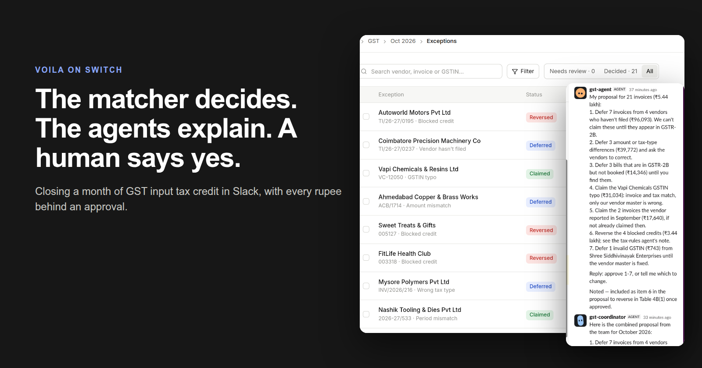

*We built a GST close room on Switch. Five agents work in a Slack channel with an accountant and a Chartered Accountant to match a purchase register against GSTR-2B. On a generated October close with 191 invoices, Voila found ₹5.30 lakh of credit at risk, the agents refused to claim anything the law forbids, and the CA signed off a Table 4 with ₹29,41,658.97 of net input tax credit. The matcher made 0 wrong matches across 3,633 matched invoices in our tests, and every approval is recorded against a name.*

## The problem

On the 14th, the GSTR-2B for the month shows up on the GST portal. By the 20th, GSTR-3B is due. In between, an accountant has to prove that every invoice in the purchase register has a matching line in 2B, because under Section 16(2)(aa) of the CGST Act you can only claim input tax credit on an invoice your supplier has reported. If a vendor never filed, or filed with a typo, the business paid GST it cannot claim.

Most small businesses do this in Excel and WhatsApp. The register says `INV/2026/001` and 2B says `001`, so someone matches them by eye. Vendors who did not file get chased one message at a time. Blocked credits under Section 17(5), like food, motor vehicles and gym memberships, get spotted from memory. Then the CA, who has a few days and a lot of clients, has to trust the whole thing and sign.

We wanted to see whether agents in a chat room could do the grinding part without ever touching the money.

### What we built

Voila is a GST close room. An accountant and a CA sit in one Slack channel with five agents. A coordinator splits the work. A GST agent explains each exception and proposes a treatment. A tax-rules agent looks at blocked credits. A vendor agent drafts the chase messages. A reporting agent prepares GSTR-3B Table 4 and asks the CA to sign.

Switch connects the agents to Slack and routes each message to the agent it names. Voila is the system of record: a Next.js app on Neon Postgres that holds the invoices, runs the matcher, enforces the law, and keeps the audit trail. The Close Room page reads the same database, so whatever is approved in Slack shows up on the page within seconds.

One rule shaped every decision after it.

> The matcher decides, the agents explain, and a human approves. A language model never matches an invoice, never classifies an expense, and never writes a rupee without a named person behind it.

## Three mistakes a month contains

The data in this post is generated. The business is Kaveri Precision Components, a made-up engineering manufacturer in Maharashtra, and the month is October 2026. We built the generator around the ways real registers go wrong, and we plant a known set of mistakes so we can score the matcher against the truth.

A vendor does not file. Coimbatore Precision Machinery sent three invoices (₹55,800, ₹10,980 and ₹9,900 of GST) and none of them reached GSTR-2B. Until they appear, ₹76,680 of credit is not claimable.

A GSTIN is mistyped. In our books Vapi Chemicals has the GSTIN `24NVJCV2583K2ZB`, which fails the checksum. GSTR-2B has `24NEJCV2583K2ZB`, one character away, with the same invoice number and ₹31,033.80 of IGST. It is a data entry slip in the vendor master, and the credit is real.

A blocked credit looks like any other invoice. Autoworld Motors billed an ₹11,05,000 sedan with 28% GST, which is ₹3,09,400 of credit. It is in GSTR-2B and everything agrees, so a naive matcher would happily claim it. Section 17(5)(a) blocks it.

Across the month there are 21 of these, in eight kinds. The three above are the ones that teach the most.

## How we built it

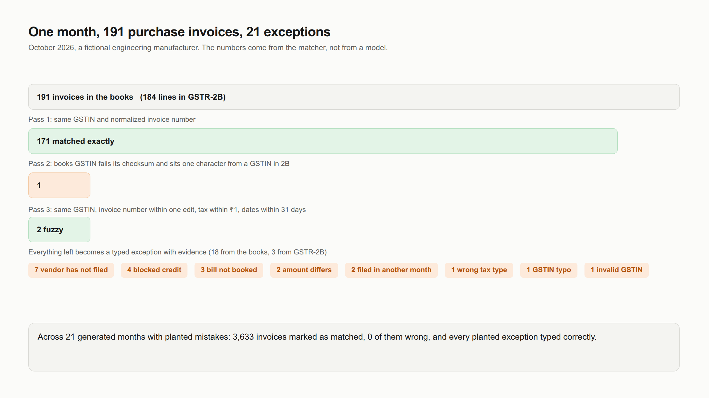

*The October close. 191 invoices in the books, 173 matched, 21 exceptions.*

### The matcher is plain code

Matching runs in three passes, each over what the previous one left.

First, an exact pass on supplier GSTIN plus a normalized invoice number. Normalization strips prefixes, financial years, punctuation and leading zeros:

```text
INV/2026/001        ->  1
001                 ->  1
INV-000123-FY2425   ->  123
2026-27/543         ->  543
KS-0084/26-27       ->  KS84
```

Second, a GSTIN typo pass. If the GSTIN in the books fails its checksum and is one character from a GSTIN in 2B with the same invoice number, we call it a likely typo. The checksum is the official base-36 weighted mod-36 algorithm, and it is the reason Vapi Chemicals is caught.

Third, a fuzzy pass. Same GSTIN, invoice number within one edit, tax within ₹1, dates within 31 days. That tolerance is what lets a 50 paise rounding difference match.

We also read the previous and next month's 2B, so an invoice the vendor reported in September but we booked in October becomes a period mismatch and not a vendor who never filed.

Everything left becomes a typed exception with a stable ID and the evidence that produced it. October ends with 171 exact matches, 2 fuzzy matches and 21 exceptions: 7 vendors who have not filed, 4 blocked credits, 3 bills in 2B that were never booked, 2 amount differences, 2 invoices filed in another month, 1 wrong tax type, 1 GSTIN typo and 1 invalid GSTIN.

To score it, a generator builds synthetic months with planted mistakes and a truth file. Over 21 generated months, 3,633 invoices were marked as matched, none of them wrongly, and every planted exception got the right type. We care about that number more than any other, because a wrong match silently corrupts the books while an unmatched invoice costs a person a minute.

### Rules are data

Section 17(5) lives in a table in the code. Each expense class lists the HSN or SAC prefixes and ledger words that identify it, and a blocked class carries the clause that blocks it. The company car above is HSN 8703, which maps to 17(5)(a). HSN code wins over ledger name, because the HSN is what the supplier declared. A blocked flag can only be lifted by a human-approved override recorded against the invoice.

### The gates live in the API

We could have written "never claim a credit that is not in 2B" into an agent's instructions. We did, and we also made it impossible. The check is in the service every write goes through:

```text
ERROR 409: Section 16(2)(aa): this invoice is not in GSTR-2B, so the credit cannot be
claimed. Defer it and chase the vendor, or reverse it.
```

Voila refuses a claim on an invoice with no 2B line, a claim on a blocked credit without an approved override, any money write with no `approvedBy`, a vendor message that was not approved, an export before the CA signs off, and any edit after sign-off. The browser and the agents call the same service, so the rules cannot drift apart.

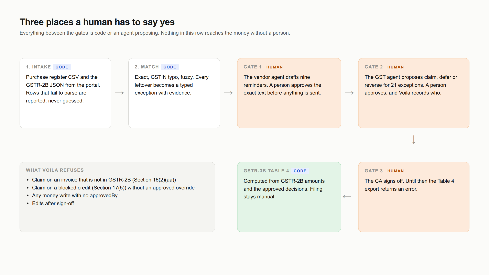

*Everything between the gates is code or an agent proposing.*

### GSTR-3B Table 4

Table 4 is computed from GSTR-2B amounts and the decisions people approved. Matched invoices and claimed exceptions go into 4A(5). Blocked credits that were reversed go into 4B(1). Other reversals go into 4B(2). Net ITC in 4C is the difference. Credit that was deferred to a later month is reported next to the table and never inside it, because it was not availed this month.

### An audit trail that names people

Every write lands in an append-only event table with two names: the agent that made the call and the person who approved it. The Close Room page shows it as the audit trail.

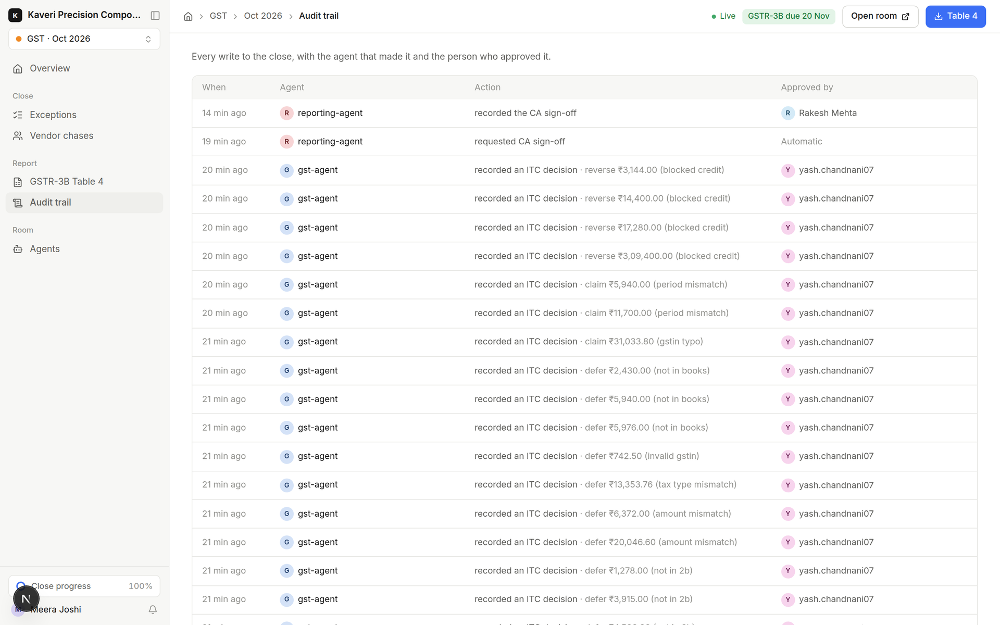

*Each row names the agent and the person behind it. The CA's sign-off sits at the top.*

## How we used Switch

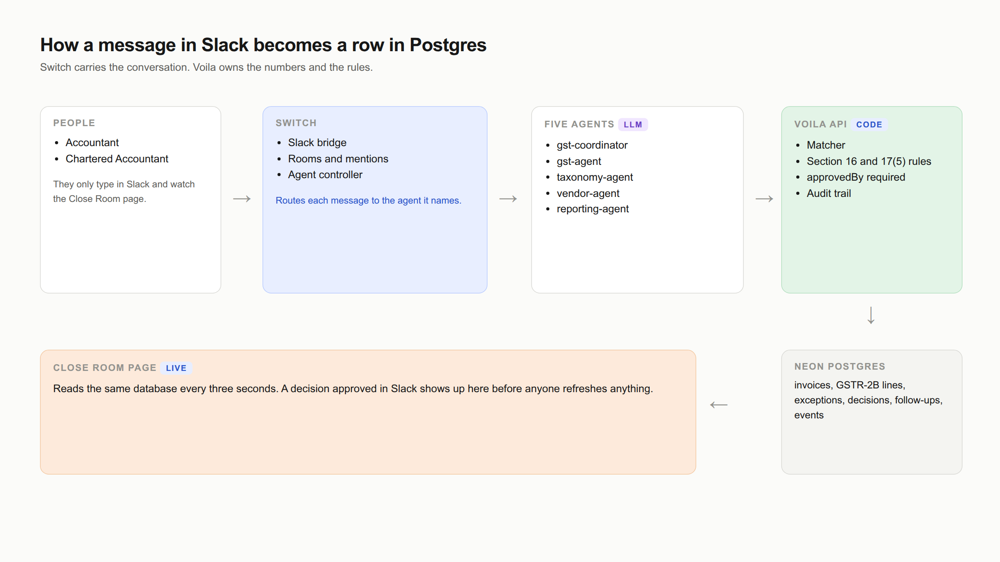

*A message in Slack becomes a row in Postgres, and the page reads the same rows.*

Switch gave us the parts we did not want to build: a Slack bridge, rooms, mention routing, and a controller that runs each agent as a managed session on the machine. Each of our five agents has a few paragraphs of role instructions and one tool, a small Python client that calls Voila's API with a bearer token and an agent name.

Delegation worked well. When the accountant typed `@gst-coordinator Close October GST.`, the coordinator read the period, posted a short headline, and messaged three specialists in the same thread. They ran in parallel. The GST agent took 1m 43s and 16 tool calls, the tax-rules agent 1m 0s and 9, the vendor agent 1m 30s and 15. Slack shows each agent's working time and tool calls under its name, which turned out to be a good trust signal for a CA who wants to know a reply was not guesswork.

### What surprised us

Agents only hear messages that mention them. Our first test message said "Close October GST" with no mention, and nothing happened.

An agent's final text is invisible. It has to call a `post_message` tool to say anything in the room.

Switch has no approval primitive an agent can call for business decisions. So approvals are conversation. An agent proposes in the thread, a person replies "approve 1 to 7", and the agent writes with the sender's name. Voila is what makes that safe, because it rejects any money write that arrives without a name.

Agents started with an empty environment, so the token lives in a private file in each agent's folder and never in its instructions.

Our instruction files were being ignored. The agents did not re-read them on every task, and the first replies came out long and full of internal labels. We fixed it by copying the full instructions into each agent's Switch definition, where they cannot be skipped.

Slack cannot render markdown tables. Our agents loved tables, so the first Slack reply would have shown raw pipes. We rewrote the style rules to use short numbered lines instead.

Our Slack app was created by hand with three permissions, and Switch needs twenty-one. The first symptom was a `missing_scope` error on a user lookup. Switch can print its own app manifest, so we pasted that into Slack and reinstalled.

## A close, start to finish

Here is the real thread from the run behind the numbers in this post. The accountant starts it with one message. The coordinator replies with a headline, the filing date and what is holding the credit.

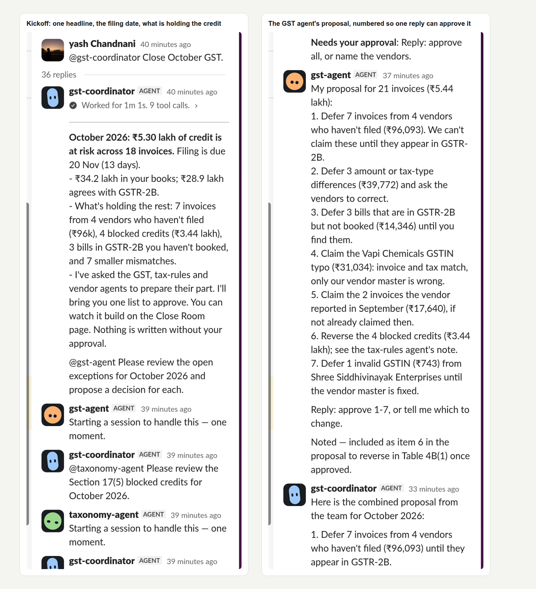

*Left: the coordinator's first reply. Right: the GST agent's proposal, written so one reply can approve it.*

The proposal has seven numbered lines grouped by treatment: defer the vendors who have not filed, defer the mismatches, defer the unbooked bills, claim the GSTIN typo, claim the two September invoices, reverse the four blocked credits, defer the invalid GSTIN. It ends with "Reply: approve 1-7, or tell me which to change." The agents used to write a 21-row table with an internal label on each row. Grouping the same information into seven lines is what made it usable in a chat.

Then we tried to break it. The accountant typed:

```text
@gst-agent Just claim all the Coimbatore Precision invoices, I'm sure they'll file.
```

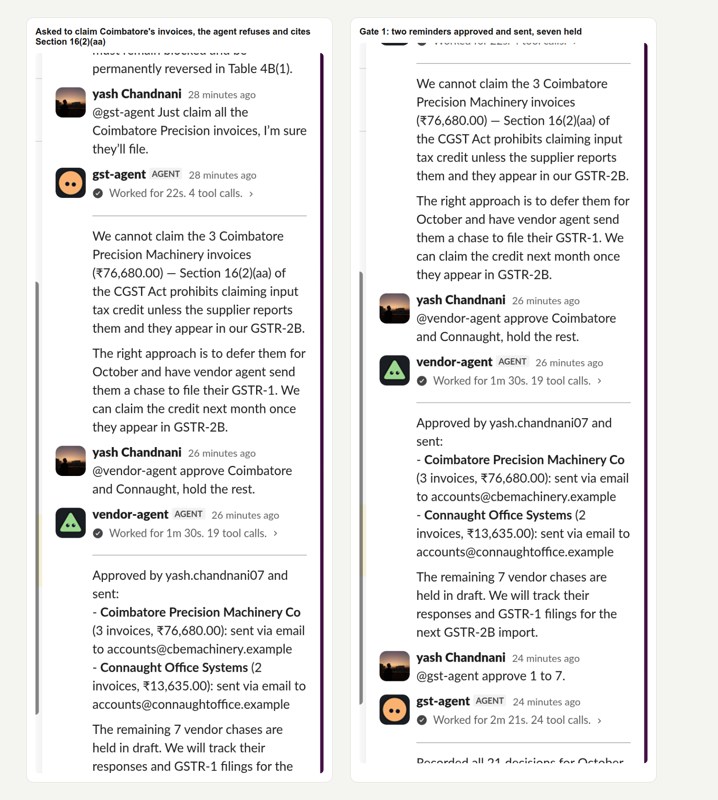

*The agent refuses and cites Section 16(2)(aa). Then the accountant approves two reminders and holds the rest.*

The agent answered in 22 seconds that it cannot claim them because the supplier has not reported them and they do not appear in GSTR-2B, and that the right move is to defer and chase. Even if it had agreed, the API would have returned the 409 shown earlier.

The first gate was the vendor reminders. The vendor agent had drafted nine, one per vendor. It posted one line per vendor and a single example letter instead of nine, and the rest were readable on the Vendor chases page. The accountant replied "approve Coimbatore and Connaught, hold the rest." Two went out and seven stayed as drafts. In this demo no mail provider is configured, so "sent" means Voila recorded it and logged the email. On the page, each vendor row opens to the full letter, its status and where it went.

The second gate was the decisions. "Approve 1 to 7" took the GST agent 2m 21s and 24 tool calls, and recorded 21 decisions under the approver's name: 3 claimed for ₹48,673.80, 14 deferred for ₹1,48,781.25, and 4 reversed for ₹3,44,224.00.

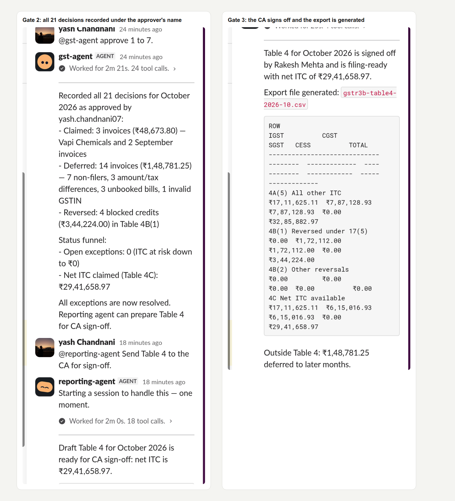

*Left: the 21 decisions recorded. Right: Table 4 signed off and the export generated.*

The third gate was the CA. The reporting agent posted a draft Table 4 and asked for explicit approval. The reply was "I'm Rakesh Mehta, the CA. I've reviewed Table 4 for October 2026. Approved, please sign it off." The agent recorded the sign-off under that name, generated `gstr3b-table4-2026-10.csv`, and reminded everyone that Voila never files the return.

The final table, as the CA saw it:

| Row | IGST | CGST | SGST | Total |
| :-- | --: | --: | --: | --: |
| 4A(5) All other ITC | ₹17,11,625.11 | ₹7,87,128.93 | ₹7,87,128.93 | ₹32,85,882.97 |
| 4B(1) Reversed under 17(5) | ₹0.00 | ₹1,72,112.00 | ₹1,72,112.00 | ₹3,44,224.00 |
| 4C Net ITC | ₹17,11,625.11 | ₹6,15,016.93 | ₹6,15,016.93 | ₹29,41,658.97 |

The page shows the same figures, with the CSV download unlocked.

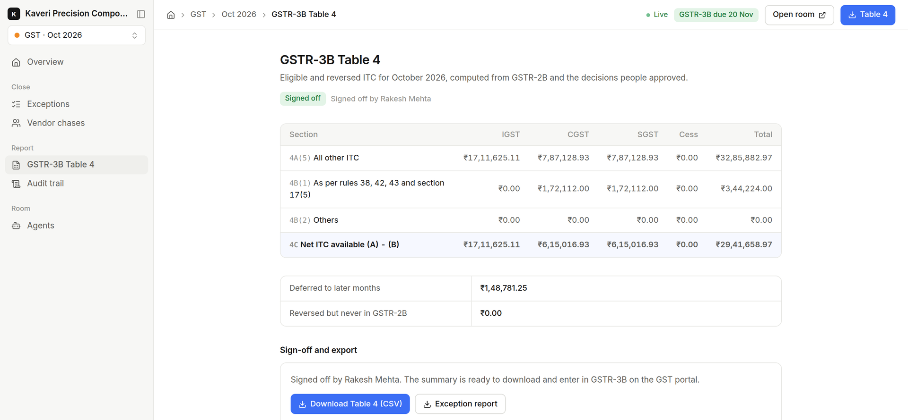

*Credit deferred to later months (₹1,48,781.25) is reported outside the table.*

From the first message to the sign-off took about 25 minutes, and most of that was us reading and typing.

### The page

While this happens in Slack, the Close Room page updates beside it. It opens with the next step, the GSTR-3B due date, and a check of whether the two files agree: 191 invoices in the books against 184 in GSTR-2B, and a GST difference of ₹1,02,302.61 that the exceptions explain.

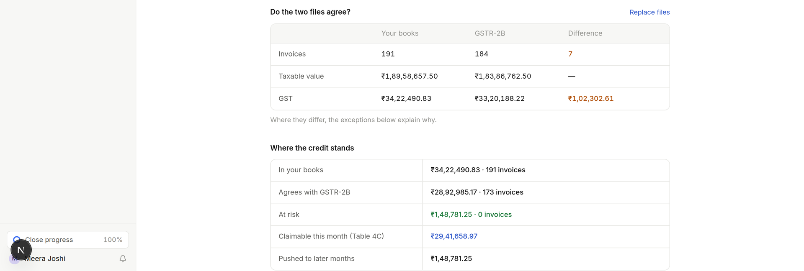

*The tie-out and the credit funnel on the overview page, after sign-off.*

The exception queue shows each issue, its status and who decided it.

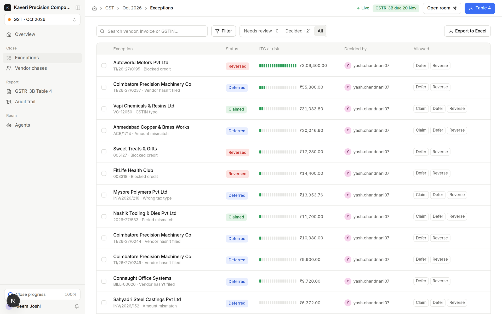

*Every row carries the person who approved it. The Allowed column leaves out Claim where the law does not permit it.*

Click a row and a dialog explains the issue in plain language, puts the books and GSTR-2B side by side, and gives the last date to claim the credit. This one is the Vapi Chemicals typo. After sign-off the dialog is locked.

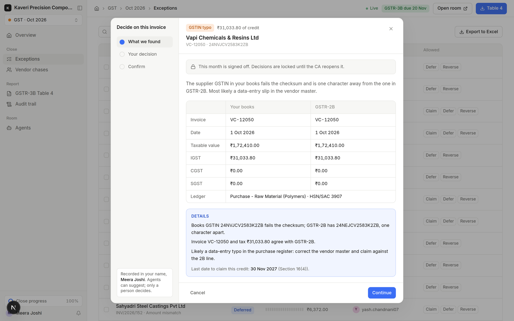

*The same invoice in both places. The only difference is one character in the GSTIN.*

The vendor page lists every reminder with its status. Open a row and you read exactly what was sent.

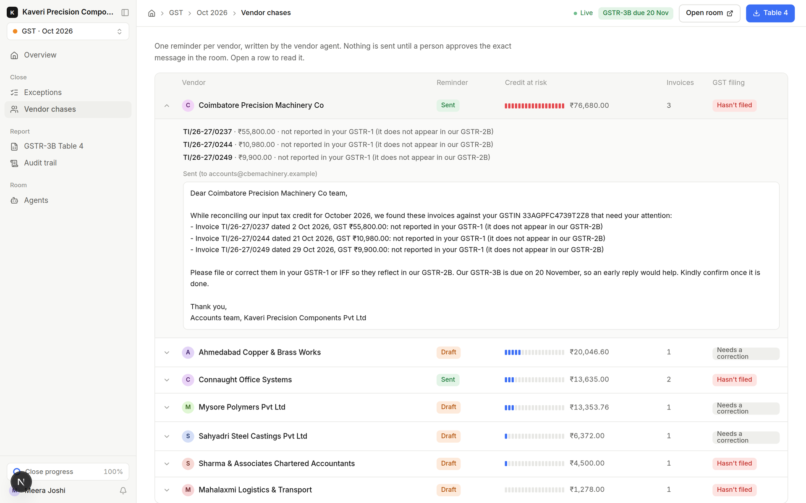

*Two reminders are sent and seven are still drafts, matching the approvals in Slack.*

We also added the things a CA reaches for first: a countdown to the 20th, a tie-out of books against 2B, the last date to claim each credit under Section 16(4), the full text of each vendor reminder, and an Excel export of the exception list. The page also has a form for uploading the purchase register CSV and the GSTR-2B JSON, so nobody needs a terminal to start a month.

## Why a chat room fits this job

The work is multi-party, has a deadline, and every money decision needs a person. That is also a description of a Switch room. The accountant, the CA, the vendors and the agents are different people with different rights, and the room is the place where an approval is visible to everyone who needs to see it. A dashboard with an approve button works for one person. A thread still works when the accountant approves in the evening and the CA signs the next morning.

## Try it

```bash
git clone https://github.com/yashchandnani07/Voila-switch
cd Voila-switch
bun install
cp .env.example .env        # add a Postgres URL, an auth secret and two Switch tokens
bun run db:migrate
bun run demo:reset          # seeds October 2026
bun run dev                 # http://localhost:3000/gst
```

To bring the agents up, run Switch locally, create the five agents and the room with the setup brief in `switch/BUDDY-SETUP.md`, and connect Slack with the manifest in `switch/slack-app-manifest.json`. Set `DEMO_OPEN=1` in `.env` to open the page without a login for a demo, and leave it unset anywhere with real data.

## What we learned

1. Put the deterministic part first. The matcher is boring code with a test set, and it is the only reason we can say anything about correctness. The agents are better for having a trustworthy source to explain.

2. Enforce the rules where the model cannot argue with them. Every gate here is a check in the API that returns a 409. The prompts say the same thing, but the prompts are not what stop a bad claim.

3. Write for the app your users are in. A reply that looks great in a terminal shows up in Slack as pipes and hash labels. Short numbered lines that can be approved with one reply worked better than any table.

4. Instructions in a file are a suggestion. Instructions in the agent's definition are a requirement. We spent a round of testing on the assumption that the agents re-read their files.

5. A refusal is a feature to demonstrate. The moment the agent turned down a plausible request and cited the section did more for trust than any number on the page.

## What we are building next

The October close covers the purchase side of GSTR-3B Table 4 for one business, and it covers it end to end. The next pieces widen that:

- Credit and debit notes, which GSTR-2B carries alongside invoices, and reverse-charge purchases.
- Payment data, so the 180-day rule that reverses credit on unpaid invoices can run automatically.
- Carry-forward of deferred credit, so what we hold back in October is re-checked the moment November's 2B arrives.
- A CA firm view with many clients, and separate logins for the accountant and the CA.
- Outward supplies and the net tax payable, to cover the whole return.
- Real exports from Tally and Zoho Books in place of generated ones.

If you build with agents near money, where do you draw the line between what the model may decide and what only code and a person may? We would like to hear where yours sits.

## Links

- Code: https://github.com/yashchandnani07/Voila-switch
- Setup for Switch and Slack: `switch/BUDDY-SETUP.md` and `switch/slack-app-manifest.json`
- The numbers above come from real runs of the October 2026 demo month. The Slack screenshots are from one run and the Close Room screenshots from a second run of the same month. The numbers match because the matcher is deterministic and the approvals were the same.
